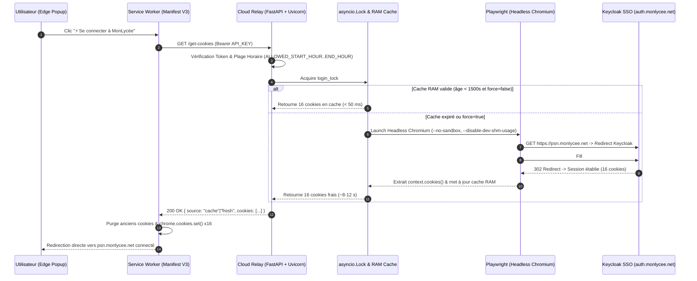

# 🔐 MonLycée Auth Relay — Cloud-Deported Zero-Trust Session Broker & Manifest V3 Extension

[](https://www.python.org/)
[](https://fastapi.tiangolo.com/)
[](https://playwright.dev/)
[](https://learn.microsoft.com/en-us/microsoft-edge/extensions-chromium/)

> **FR :** Système d'authentification déportée (*Zero-Local-Credential Session Relay*) pour **MonLycée.net (`psn.monlycee.net` / Keycloak TWIDF)**. Déporte le stockage du secret et la négociation SSO SAML/OIDC sur une instance Cloud isolée (AWS EC2 / Oracle Cloud), puis injecte les 16 cookies de session authentifiés directement dans **Microsoft Edge** via un Service Worker **Manifest V3**, sans que le mot de passe ne soit jamais stocké ni tapé sur le poste client.
>
> **EN:** Cloud-deported zero-trust authentication relay for regional academic portals (**Keycloak SSO**). Offloads credential storage, time-window policy enforcement, and headless browser SSO negotiation to a hardened remote Linux microservice (**FastAPI + Playwright**), injecting short-lived session cookies into a local **Manifest V3** browser extension with `< 50 ms` warm-cache latency.

---

## 🎯 Problem Statement & Engineering Motivation / Problématique

### Français
Dans le cadre d'un contrôle parental / disciplinaire strict (couplé à *Cold Turkey Blocker*), un élève doit pouvoir accéder quotidiennement à son espace de travail scolaire (**MonLycée.net**) **sans connaître ni posséder le mot de passe du compte** (qui lui permettrait autrement de se connecter depuis un smartphone ou en dehors des plages horaires autorisées).
Les gestionnaires de mots de passe classiques échouent face à ce modèle de menace, car l'utilisateur local (ayant accès aux DevTools du navigateur) peut inspecter le champ `<input type="password">` ou lire le stockage local de l'extension.

**Solution architecturale :** Séparer physiquement l'**authentification** (exécutée sur un serveur Cloud distant détenant le secret) de l'**utilisation de la session** (exécutée sur le navigateur local via injection directe des cookies de session post-authentification).

### English
Standard password managers cannot protect credentials against a local user who has physical access to the machine and browser DevTools (`<input type="password">` inspection). To allow an end-user to access a federated **Keycloak SSO** portal during strict study hours without ever exposing the underlying account password:
1. **Credential Isolation:** The account password lives exclusively on a remote cloud VM (`AWS EC2` / `Oracle Cloud`) protected by environment secrets.
2. **Server-Side SSO Negotiation:** A headless Chromium worker orchestrated by **Playwright** performs the multi-redirect Keycloak authentication flow remotely and extracts the resulting `HttpOnly` / `Secure` / `SameSite` session cookies.
3. **Mutex-Locked RAM Caching:** An `asyncio.Lock()` mutex prevents concurrent browser launches (eliminating `ERR_INSUFFICIENT_RESOURCES` socket exhaustion) and serves warm session cookies from memory in **`< 50 ms`** (TTL = 25 min).
4. **Client-Side Cookie Injection:** A **Manifest V3** Service Worker (`background.js`) fetches the cookies over HTTPS (`Bearer` token) and injects them into the browser cookie jar via `chrome.cookies.set()`, bypassing the login screen entirely.

---

## 🏛️ System Architecture / Architecture du Système



---

## ⚡ Key Technical Features / Points Forts Techniques

| Composant | Détail d'implémentation | Impact / Performance |
| :--- | :--- | :--- |
| **Concurrency Control (`asyncio.Lock`)** | Double-checked locking autour de `fetch_fresh_cookies()` dans `server/server.py` | Évite le lancement simultané de plusieurs instances Chromium lors de clics multiples |
| **In-Memory Session Cache (`CACHE_TTL`)** | Cache mémoire avec TTL configurable (`1500s` = 25 min) et endpoint `/clear-cache` | Latence réduite de **`~10 s`** (cold Playwright login) à **`< 50 ms`** (warm cache) |
| **Socket Exhaustion Mitigation** | Stratégie `wait_until="domcontentloaded"` + prédicat d'URL post-Keycloak | Résout le bug `ERR_INSUFFICIENT_RESOURCES` causé par les centaines de sous-requêtes ENT |
| **Time-Window Policy Enforcement** | Contrôle horaire côté serveur (`ALLOWED_START_HOUR` / `ALLOWED_END_HOUR`) | Bloque l'émission de sessions (`HTTP 403`) en dehors des heures d'étude autorisées |
| **Manifest V3 Cookie Normalisation** | Reconstruction stricte de l'URL cible (`http`/`https` + domaine + path) et nettoyage `sameSite` (`strict`, `lax`, `no_restriction`) dans `background.js` | Injection 100% compatible avec les cookies `HttpOnly`, `Secure` et domaines préfixés `.monlycee.net` |
| **Zero-Maintenance Cloud Provisioning** | Script `server/setup_oracle.sh` (création automatique d'un fichier Swap 2 Go, installation dépendances APT/Playwright, daemon `systemd` `monlycee-relay.service`) | Survit aux crashs OOM sur petites instances Cloud (1 Go RAM) et redémarre au boot |

---

## 📁 Repository Structure / Structure du Dépôt

```text
monlycee-relay/
├── edge-extension/          # Extension navigateur Chromium / Microsoft Edge (Manifest V3)
│   ├── manifest.json        # Permissions: cookies, storage, tabs, host_permissions (*.monlycee.net)
│   ├── background.js        # Service Worker: appels API, purge et injection chrome.cookies.set()
│   ├── popup.html / .css    # Interface utilisateur Fluent Design (statut temps réel, actions)
│   ├── popup.js             # Contrôleur UI (connexion rapide, refresh forcé, purge session)
│   └── icons/               # Icônes 16x16, 48x48, 128x128
├── server/                  # Microservice Cloud de relais d'authentification
│   ├── server.py            # API FastAPI (/get-cookies, /clear-cache, /health) + Playwright
│   ├── requirements.txt     # Dépendances Python (fastapi, uvicorn, playwright, python-dotenv)
│   └── setup_oracle.sh      # Provisionnement automatisé Ubuntu (Swap 2GB + systemd daemon)
├── hf-space/ & hf-gradio/   # Variantes conteneurisées (Docker / Hugging Face Spaces)
└── test_login.py            # Script de diagnostic Playwright local (lecture .env)
```

---

## 🚀 Quick Start / Installation & Déploiement

### 1. Déploiement du Serveur Cloud (Ubuntu / AWS EC2 / Oracle Cloud)
```bash
git clone https://github.com/joshdeutc/monlycee-relay.git
cd monlycee-relay/server
chmod +x setup_oracle.sh
./setup_oracle.sh
```
Puis configurer les variables d'environnement dans `/etc/systemd/system/monlycee-relay.service` :
```ini
Environment="API_KEY=votre-cle-api-secrete"
Environment="ENT_USER=identifiant.ent"
Environment="ENT_PASS=mot-de-passe-ent"
Environment="CACHE_TTL=1500"
Environment="ALLOWED_START_HOUR=8"
Environment="ALLOWED_END_HOUR=22"
```

### 2. Test en Local (Développement)
```powershell
cd server
python -m pip install -r requirements.txt
python -m playwright install chromium
python -m uvicorn server:app --host 127.0.0.1 --port 8000
```

### 3. Installation de l'Extension Microsoft Edge / Chrome
1. Ouvrir `edge://extensions` (ou `chrome://extensions`).
2. Activer le **Mode développeur**.
3. Cliquer sur **Charger l'extension décompressée** (*Load unpacked*) et sélectionner le dossier `edge-extension/`.
4. Cliquer sur **⚡ Se connecter à MonLycée** pour injecter la session en 1 clic.
